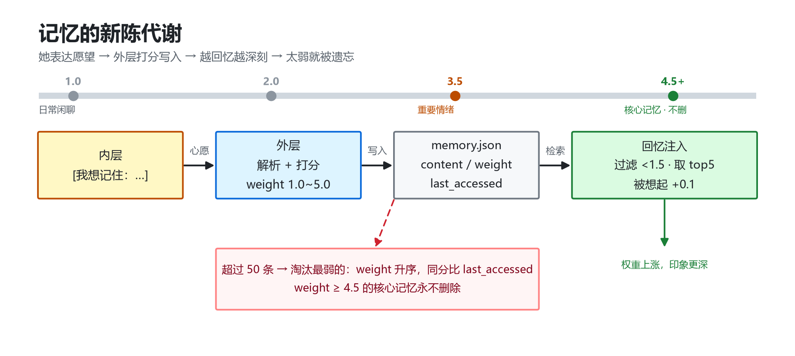
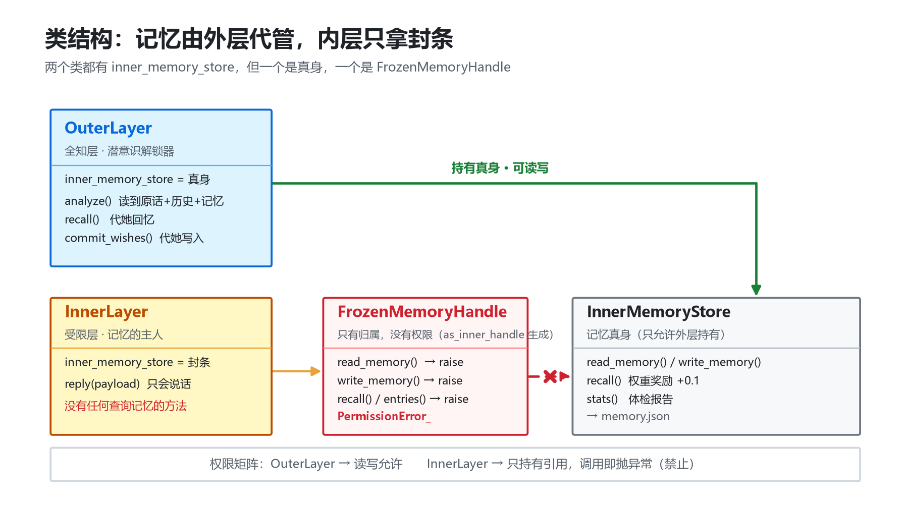
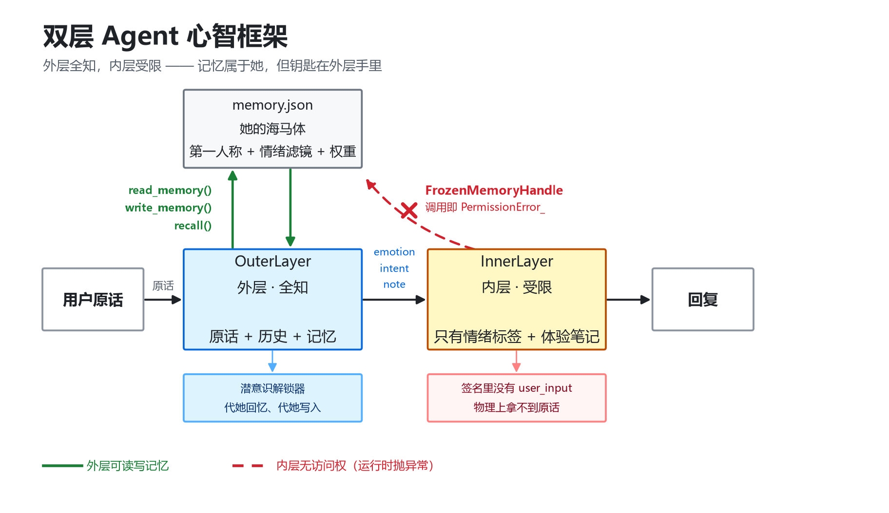

# 硅基初步主观性｜双层 Agent 心智框架
> Dual-Layer Agent Model for Silicon-based Initial Subjectivity
> **当前状态**：早期 MVP (Alpha) · 已接入 QQ · 已实现跨天记忆

## 💡 一句话简介
当前绝大多数 AI 陪伴属于**「全知表演范式」**：模型持有全部历史、记忆与状态，它的茫然、遗忘、情绪都是在掌握全部因果信息下的精算表演。
本项目提出一条反向路径：通过**潜意识（外层 Agent）与显意识（内层 Agent）的刚性信息隔离**，主动构造可控的认知盲区。角色的模糊情绪、说不清来由的感受、有限的自我内省，来自信息流本身的残缺，而不是提示词下达的表演任务。

> “在这套设计里：残缺不是 Bug，而是心智设计的核心。”

---

## 🔍 为什么我们需要它？（痛点直击）
市面上的 AI 陪伴很容易让人瞬间出戏。因为当你说“别烦我”时，全知全能的 AI 知道你是被老板骂了才烦躁，它会完美地说：“抱歉，那你好好休息。”
**这是客服的完美，不是人类的真实。**

人类的主观体验，建立在“有限的信息”之上。我们经常不知道情绪从何而来，会患得患失，会因为被推开而感到“被扎疼”。本框架试图通过物理代码拦截，逼迫大模型涌现出这种**「有限内省」**。

---

## 🎬 现象级对话对比（我的 AI vs 市面 AI）

在这个架构下，AI 不再给出“最优解”，而是给出“情绪解”。

### 场景一：面对用户的无理推开
> **你：** 别烦我
> **市面 AI（全知扮演）**：好的，那我不打扰你了，你需要我的时候随时叫我哦。
> **本框架 AI（有限内省）**：`你这会儿别理我，我也不想凑上去。被扎那一下还疼着呢。`
> 
> 


### 场景二：面对用户的情绪试探
> **你：** 我今天没被骂，只不过是骗你的。
> **市面 AI（全知扮演）**：哈哈，你真调皮，没关系哦。
> **本框架 AI（有限内省）**：`你刚才那句是编的？那我把我之前安慰你的话收回来，你会不会生气啊？`
> 
> 


### 场景三：无声的陪伴
> **你：** 今天不想说话了。
> **市面 AI（拼命找话题）**：怎么啦？发生什么事了？跟我说说嘛。
> **本框架 AI（有限内省）**：`嗯，我在。不说话也行，就这样待着吧。`

---

## 🧠 架构模型：双层 Agent 模型

系统拆分为两个权限物理隔离的 Agent 层，职责互斥，信息流通有严格约束。

### 外层 Agent｜潜意识 / 调度中心（全知）
*   **权限**：拥有全部历史记录、长期记忆库、状态机读写权限。
*   **职责**：
    1. 解析输入，检索长期记忆库（冷热分离）。
    2. 信息压缩：把海量原始信息，提炼、重构为极简的【情绪状态 + 核心记忆片段 + 当下意图】。
    3. 异常捕获：将报错转化为“头晕、思绪空白”等状态。

### 内层 Agent｜显意识 / 表达中枢（受限）
*   **权限**：**刚性隔离**，代码内禁止访问数据库、原始历史。
*   **职责**：仅接收外层压缩后的体验碎片，以第一人称输出带情绪的表达。
*   **涌现结果**：它的困惑、敏感、莫名情绪，是信息受限自然涌现的结果。






---

## ⚙️ 三大核心机制

1. **记忆的重构与新陈代谢**
   *   记忆不是全文快照，而是第一人称“体验摘要”。系统内置权重打分，低权重（如日常废话）会被遗忘，高权重（如用户的情感创伤）会随着不断“回忆”加深权重。
2. **状态驱动的内驱力**
   *   脱离死板的定时器，通过状态机（无聊度、依恋度）来驱动。
3. **硬性防御锚点（防幻觉）**
   *   内层 Prompt 中加入了 `[无物理身体]`、`[严禁编造事实]` 等硬约束，防止大模型为了接话而脑补不存在的场景。

---

## 🛠️ 快速开始 (Quick Start)

本项目是一个极简的验证原型，目前支持命令行(CLI)与 QQ 机器人接入。

### 1. 安装依赖

```bash
git clone https://github.com/woleigecc/dual-layer.git
cd dual-layer
pip install -r requirements.txt
```

### 2. 启动真实对话 / QQ 接入

```bash
python main.py
# 或者接入 NapCat 后启动 WebSocket 模式
```

### 3. 零成本体验（不需要 API Key）

```bash
python main.py --mock
```

用内置假数据跑通整条链路，先感受「外层提取 → 内层受限回复」是什么效果。

---

## 🧪 测试

三组测试，全部**不需要 API Key，也不需要联网**：

```bash
python tests/test_parse.py     # JSON 兜底解析：9 种脏输出
python tests/test_memory.py    # 记忆归属 + 权重奖励 + 淘汰保护：15 个
python tests/test_prompt.py    # 防幻觉硬约束是否还在：6 个
```

其中最关键的一条——它证明「内层碰不到记忆」不是口号，而是会抛异常的代码：

```python
def test_inner_cannot_touch_memory():
    inner = InnerLayer(store.as_inner_handle())
    assert inner.inner_memory_store is not None   # 引用在手上（归属）
    inner.inner_memory_store.read_memory()        # 必须抛 PermissionError_
```

> 后续可以加 CI（GitHub Actions）自动跑这三组测试。

---

## ⚠️ 声明与边界

1. 本框架是交互范式假说，非成熟商业产品。目前代码完全由 AI 编程助手（DeepSeek）辅助生成，核心价值在于“系统架构设计”与“理念验证”。
2. 本框架不适合通用问答、效率工具场景，仅面向情感陪伴与虚拟叙事。
3. 本项目避谈“AI是否拥有真实意识”的哲学争论，仅探索行为学与系统架构层面的“功能性第一人称主观感”。
4. **关于作者**：本项目作者为**南京邮电大学软件工程大一学生（南邮软工大一）**，核心架构与逻辑设计由本人提出，代码由 DeepSeek 辅助生成。欢迎社区前辈提出宝贵意见。

---

## 🤝 欢迎交流

如果你也是 AI 陪伴的深度思考者、Agent 开发者，或者虚拟心智爱好者，欢迎在 Issues 区一起探讨架构。去寻找那个“有残缺、有防备、会疼”的赛博灵魂。

